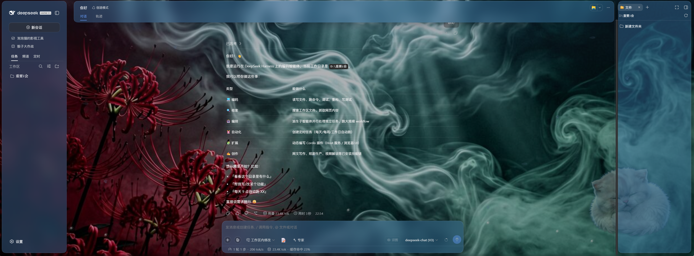
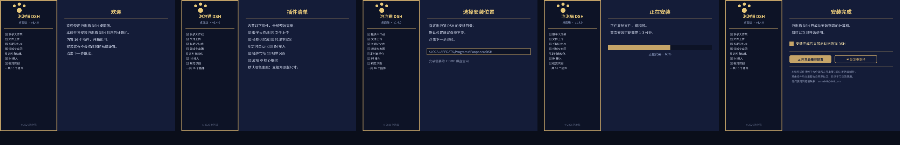

# 🖥️ 泡泡猫 DSH 桌面版 · 打包工程（Windows + macOS）

> 把 DeepSeek Harness（DSH）连同整套插件，打成**双击即用**的 Windows 安装器与 macOS 应用包。
> 这个仓库是**构建工程**：安装器脚本、启动器、打包与校验工具链。

[](./LICENSE)


<p align="center"></p>

## 这是什么

DSH 本体是命令行 / 网页形态的 AI 工作台，普通用户想在本机跑起来，得先装 Node、配环境、装插件。
这个工程把整套东西塞进安装包：**自带运行时、预装插件、数据全在本机**。

| 项目 | 当前口径 |
|---|---|
| 交付版本 | **v3.1.15** |
| DSH 本体 | `@deepseek-ai/dsh` **0.1.7-rc.2** |
| 预装插件 | **18 个** bundle（含长期记忆库 `dsh-mnemon` + 16 个子包 + 内置 Mnemon CLI） |
| Windows 产物 | NSIS 安装器，约 389 MB |
| macOS 产物 | 脚本安装 zip，约 586 MB（通用包，Intel + Apple Silicon） |

**为什么这么大**：内含完整运行时（Node 22、便携 Python 3.11 双架构、MinGit）与全部插件依赖，
用户那边不需要再装任何东西。这是刻意的取舍。

## 快速开始

### Windows

```bash
# 依赖：Node 22+、Python 3.9+、NSIS 3.08（makensis）
bash win/rebuild.sh     # 修依赖层 → 实体化符号链接 → 干净目录编译 → 五项校验
# 产物：win/dist/PaopaocatDSH-Setup-v3.1.15-x64.exe
```

### macOS

```bash
# 依赖：Node 22+、Python 3.9+（zip / rsync 用系统自带）
cd mac
python3 mkzip.py dist/PaopaocatDSH.app dist/PaopaocatDSH-macOS-v3.1.15-universal.zip
# 「脚本安装.zip」= 上面的 zip + 安装泡泡猫DSH.command + 使用说明.txt
```

### 校验（对**最终交付物**，不是构建中间态）

```bash
7z x -y -o/tmp/v win/dist/PaopaocatDSH-Setup-v3.1.15-x64.exe
python3 tools/verify-payload.py /tmp/v
```

五项检查，缺一项都不算通过：版本一致性 ｜ 全部插件 import ｜ 内置 Mnemon CLI 可识别 ｜
启动器守卫齐全 ｜ 真启动抓首页必须是 200。**被跳过的项必须单列「未执行」——跳过 ≠ 通过。**

## 目录结构

```
win/                    Windows 工程
├── installer.nsi         NSIS 安装器脚本
├── rebuild.sh            一键构建（含全部已知坑的处理）
├── launcher/             start.ps1 / first-run.ps1 / stop-running.ps1 / check-settings.cjs
├── data-template/        安装后释放到 %APPDATA% 的脚手架
│   ├── settings.yaml
│   ├── .env.example
│   └── profiles/web/     cordis.yml / cordis.patch.yml / package.json（插件清单）
├── paopaocat.ico         安装器图标
└── README.txt            安装器内附的用户说明

mac/                    macOS 工程
├── build.sh              .app 骨架与三处补丁（Safari polyfill / PATH / 原生包体检）
├── mkzip.py              zip 打包（唯一能保住符号链接的写法）
├── 安装泡泡猫DSH.command   一键安装脚本（解压 → 装到 /Applications → 清拦截 → 启动）
├── launcher/             注入 .app 的启动器（start.command / check-settings.cjs / bin/git）
├── 安装说明.md            面向用户的安装说明与原理问答
└── 用户说明书.md

tools/
├── fix-profile-deps.py   修 profile 依赖提升层 + 清插件内旧副本
└── verify-payload.py     五项交付校验

docs/                   技术文档、构建与验证记录、历史版本说明
assets/                 图标、安装向导位图、截图、营销图
legacy/                 v2.x 时代的 Windows 工程与离线依赖（保留供追溯）
```

## 六条铁律（违反即故障）

1. **NSIS 必须 `LC_ALL=C.UTF-8 makensis`**。默认 POSIX locale 下，脚本里出现任何非 ASCII
   （中文文件名、中文 UI 串）都会段错误 `exit 139`。同理不要用 `SetCompressor /solid lzma`
   或 `bzip2`，用默认 `zlib`。
2. **编译目录必须只含 payload**。`File /r` 会连带遍历父目录的兄弟目录，在工程目录里直接编译
   会把构建暂存目录一起打进包（实测多 806 条目 / +87 MB）。`rebuild.sh` 已先 `cp -al` 到独立构建目录。
3. **payload 里不能有指向外部的绝对符号链接**：NSIS 会跟随打包，用户机上是死链。
4. **macOS zip 必须用 `ZipInfo` 手工写**（`S_IFLNK` + `ZIP_STORED`，内容=链接目标）。
   用 `ZipFile.write()` 会把链接存成实体副本，体积暴涨约 30 MB。`mkzip.py` 已实现并自检死链。
5. **macOS 11~14 必须带 JS 回退垫片**。官方 `node-addon-require-builtin` 的 darwin 预编译二进制
   `minos=15.0.0`（要求 macOS 15，且 arm64 带签名改不得），而 DSH 0.1.7 的 `dsh-app-boot`
   启动时**无条件**加载它——所以「加 `--expose-internals` 绕过」只对 `cordis-plugin-loader` 有效。
   `mac/launcher/` 的垫片在原生不可用时回退到 Node 内部 require。
6. **覆盖安装必须清空程序目录并整层重建 `node_modules`**。NSIS / robocopy / rsync 只覆盖不删除，
   旧副本会遮蔽新版：表现为插件 `failed to import`，或页面空 body 的 HTTP 400
   （import 全过也照样 400）。

> 更多坑位（`cp -al` 跨盘 EXDEV、硬链接就地写穿源目录、`pkill -f` 自杀等）见
> [`docs/构建与验证记录-v3.1.15.md`](./docs/构建与验证记录-v3.1.15.md)。

## 它长什么样

<p align="center">
  
</p>

<p align="center">
  
</p>

## 下载成品

安装包在自建下载站（不进仓库，避免仓库膨胀）：

- 下载页：<https://soft.zmm168.top/apps/paopaocat-dsh-v3115>
- Windows：<https://soft.zmm168.top/d/paopaocat-dsh-v3115/windows>
- macOS：<https://soft.zmm168.top/d/paopaocat-dsh-v3115/macos>

## 相关文档

| 文档 | 内容 |
|---|---|
| [`docs/构建与验证记录-v3.1.15.md`](./docs/构建与验证记录-v3.1.15.md) | 五个真机故障的根因取证与修复、五项校验的由来、五种「假通过」 |
| [`docs/任务交接-v3.1.12.md`](./docs/任务交接-v3.1.12.md) | 交给下一位维护者的完整背景与铁律 |
| [`win/README.md`](./win/README.md) | Windows 构建细节（payload 怎么准备、NSIS 参数） |
| [`mac/README.md`](./mac/README.md) | macOS 构建细节（.app 骨架、符号链接、垫片） |
| [`mac/安装说明.md`](./mac/安装说明.md) | 面向用户的安装说明与原理问答 |
| [`docs/TECHNICAL_DOC-v2.3.2.md`](./docs/TECHNICAL_DOC-v2.3.2.md) | 早期版本的技术文档（历史） |

## 许可

代码与脚本：[MIT](./LICENSE)。
打包进去的 DSH 本体、第三方插件与运行时（Node.js、Python、MinGit 等）遵循各自许可证，
详见上游仓库与 `legacy/downloads/` 中各组件自带的许可文件。

---

> 除泡泡猫自研插件外，其余插件均收集整合自开源社区，仅供学习交流使用。
